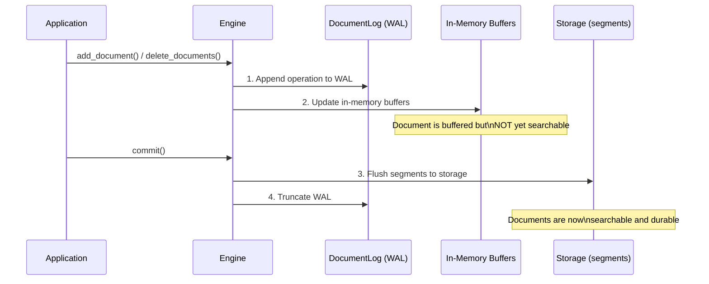
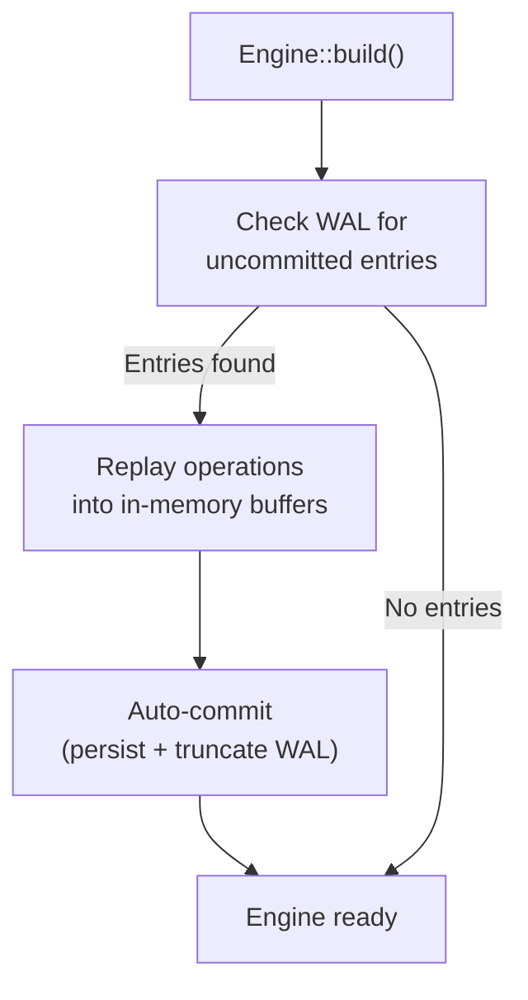

# 永続化とWAL

Laurusはデータの耐久性を確保するために**Write-Ahead Log（WAL）**を使用します。すべての書き込み操作はインメモリ構造を変更する前にWALに永続化され、プロセスがクラッシュした場合でもデータが失われないことを保証します。

## 書き込みパス



### 主要な原則

1. **WALファースト**: すべての書き込み（追加または削除）はインメモリ構造を更新する前にWALに追記されます。書き込みを拒否しうる処理（ベクトルフィールドの埋め込みと検証、writer の作成、語彙フィールドの解析、満杯の語彙バッファのフラッシュ）はすべてこの追記より前に行い、追記より後の失敗では、索引を開き直すまで書き込みを止めます。追記から完了までの書き込みは `.await` を挟まずに進むので、呼び出しのキャンセルで書き込みが途中で止まることはありません（[失敗した書き込み](#失敗した書き込み)を参照）
2. **バッファリング書き込み**: インメモリバッファが `commit()` が呼ばれるまで変更を蓄積します
3. **アトミックコミット**: `commit()` はすべてのバッファリングされた変更をセグメントファイルにフラッシュし、WALを切り捨てます
4. **コミットスコープの可視性**: Lexical セグメントは writer のバッファが埋まった時点で書き出されます。これは `commit()` よりずっと前に起こり得るため、セグメントファイルがストレージ上に存在することは、その文書が検索可能になったことを意味しません。公開とは `commit()` だけが追加する manifest エントリのことであり、セグメントの探索は manifest しか読みません。したがって「文書が検索可能になるのは `commit()` の後」という契約は、searcher がいつ構築されたかに関わらず成立します。削除も同じ手順の中で、ビットマップが永続化された後に公開されるため、セグメントを見られる reader は必ずその削除も適用できます
5. **クラッシュセーフティ**: 書き込みとコミットの間にプロセスがクラッシュした場合、次回起動時にWALがリプレイされます
6. **アトミックなファイル書き込み**: セグメントファイル（HNSW の `.hnsw` グラフ・そのメタデータ・削除ビットマップなど）は一時ファイルへ書き込んでからアトミックにリネームして配置されるため、書き込み途中のクラッシュでも切り詰められたファイルではなく直前にコミット済みのファイルがそのまま残ります
7. **チェックサム検証**: これらのファイルは CRC-32（`.hnsw` と `.hnsw.f32` rerank sidecar は footer、`metadata.json` は framing）を持ち、ロード時に検証されるため、ディスク上の静かな破損を正常データとして読まずに検出できます。チェックサム導入前に書かれたファイルもそのままロードできます（ファイル単位で任意）。語彙インデックスのセグメントパート（`.dict`・`.post`・`.docs`・`.norms`・`.ids`・`.bkd`）、削除ビットマップ（`.delmap`）、チェックサム付き manifest は、末尾に 8 バイトの footer を持ちます。footer は、それより前の全バイトの CRC-32 と、マジック `LCRC` からなります。先頭から順に読むパートは、セグメントを開いて読み込むときに検証されます。`.post` と `.bkd` はランダムアクセスで読むので、マージがセグメントを読むときに検証されます。これで、破損したデータが新しいチェックサムを付けてマージ後のセグメントへ移ることを防ぎます。マージ後のセグメントは、全パートが検証されます。document store のセグメント（`doc_segment_NNNNNN.docs`）も同じ footer を持ちます。書き込みや再オープンの後に初めて読むとき、offset index を作る際に全体が検証されます。破損していれば、そのセグメントは読むたびにエラーになります。この footer より前に書かれたファイルは、最後の書き込みだけを覆う 4 バイトの trailer で終わります。これらもそのままロードできますが、検証はされません。例外は manifest と `.ids` で、最後の書き込みがペイロード全体なので、trailer で引き続き検証されます。また、ローダーはヘッダーを信頼する前にバッファ確保サイズを実ファイルサイズで上限を縛るため、サイズフィールドが破損していても巨大なメモリ確保（OOM）を引き起こさずに破損として拒否します。語彙インデックスの Term Dictionary と posting list のデコーダも同様に、各ブロック・FST ヘッダー・スキップテーブルを writer が書く内容と照合するため、破損していれば panic せずに破損エラーを返します。デコードはできても辻褄の合わないデータも、誤った検索結果を返さずに破損として拒否します。対象は、順序が乱れた key や UTF-8 として不正な key、昇順でない block-max や NaN・負の factor を持つ block-max、重複・逆行したりセグメントの範囲外にある doc id、そして term・長さ・文書数・ブロックの境界が辞書のエントリと食い違う posting list です
8. **バージョン付きセグメントヘッダー**: ベクトルセグメントは共有ヘッダーにフォーマットバージョンを持ち、機能のはしごを形成します。バージョン 2（HNSW のみ）はグラフブロックを 64 ビットのドキュメント ID の代わりにセグメントローカルな 32 ビット ordinal で格納します（ディスク上のグラフブロックはおよそ半分になります）。バージョン 3（全ベクトルインデックス型）はセグメントごとのフィールド名辞書を追加し、各レコードはフィールド名をインラインで繰り返す代わりに 16 ビットの ID で参照します（レコードごとに名前の長さ + 2 バイト分縮小されます）。新しいセグメントはバージョン 3 で書き込まれ、古いビルドが書いたセグメント（バージョン 1・2）もそのままロードでき、次の書き直し（コンパクションやマージ）で更新されます

## Write-Ahead Log（WAL）

WALは `DocumentLog` コンポーネントによって管理され、ストレージバックエンドのルートレベル（`engine.wal`）に保存されます。

### WALエントリタイプ

| エントリタイプ | 説明 |
| :--- | :--- |
| **Upsert** | ドキュメント内容 + 外部ID + 割り当てられた内部ID、および置き換える版の内部ID（`put` の旧版。`add` にはない） |
| **Delete** | 外部IDと、削除するすべてのドキュメントの内部ID |

`put`・`add`・削除は、それぞれちょうど 1 つのエントリを書き、リカバリはそのエントリを丸ごと再生します。`put` の旧版は挿入と一緒に削除され、複数のチャンクの削除はすべてのチャンクを消します（[#1522](https://github.com/mosuka/laurus/issues/1522)）。v4 より前の WAL は、`put` の削除と、削除の各ドキュメントを、それぞれ別のエントリとして持ち、これまでどおりに再生されます。

### WALファイル

WALファイル（`engine.wal`）は追記専用のバイナリログです。各エントリは以下を含む自己完結型です。

- 操作タイプ（upsert/delete）
- シーケンス番号
- ペイロード（ドキュメントデータと内部ID）

### オンディスクのフレーミング

ファイルは 5 バイトのヘッダ（`b"LWAL"` マジック + バージョンバイト）で始まり、長さプレフィックス付きレコードが続きます。フレーミングは 4 種類あります。書き込むのは v4 だけです。アップグレードを越えて残った古いフレーミングのファイルはそのまま読み、最初の追記の前に v4 で書き直します（その前にコミットが空にした場合を除きます）。そのため、1 ファイル内でフォーマットが混在することはありません。

| バージョン | フレーミング | ペイロード |
| :--- | :--- | :--- |
| **v4**（現行） | `[u32 len][u32 crc32][payload]` | コンパクトな **rkyv バイナリ** レコード。書き込み 1 回につき 1 つ |
| **v3** | `[u32 len][u32 crc32][payload]` | rkyv バイナリレコード。`put` の削除は別のレコード（読み取り専用） |
| **v2** | `[u32 len][u32 crc32][payload]` | v3 のエントリの JSON レコード（読み取り専用・後方互換） |
| **legacy**（CRC 以前） | `[u32 len][payload]` | JSON レコード、チェックサムなし（読み取り専用） |

CRC-32（v2 以降）は `len || payload` に対して計算され、長さの破損と本体の破損の両方を検出します。reader は 4 形式すべてを復旧できるため、古いビルドで書かれた WAL もアップグレード後に replay できます。

v3 以降、各ペイロードは JSON ではなくコンパクトな rkyv バイナリレコードです。ベクトルは十進文字列ではなく生の `f32`（各 4 バイト）で格納されるため、ベクトルが多いドキュメントでは WAL がおよそ 2〜3 倍小さくなり、replay もそれに応じて高速化します。耐久性は変わりません（CRC フレーミングとリカバリのセマンティクスは不変）。

ヘッダがこのビルドの知らないバージョンを示す WAL は、新しいビルドが書いたものです。索引を開くと、バージョンを名指しするメッセージ付きの `LaurusError::IncompatibleFormat` で失敗し、ファイルはそのまま残るので、新しいビルドでまだ再生できます（[#1507](https://github.com/mosuka/laurus/issues/1507)）。逆に、古いビルドは v4 の WAL を読めません。v4 より前のビルドは v2 として読み、何も復旧しません。コミットすると WAL は空になるので、新しいビルドでコミットした索引には WAL のレコードが残りません。

## リカバリ

エンジンがビルドされる際（`Engine::builder(...).build().await`）、残っているWALエントリが自動的にチェックされ、リプレイされます（WALはコミット時に切り捨てられるため、残っているエントリはクラッシュしたセッションのものです）。リカバリの最後には**自動コミット**が実行されます。リプレイされた状態 —
[グループコミットで永続化される](deletions.md#グループコミットによる永続化)削除を含む — は
永続化されて即座に検索可能になり、WALは切り捨てられるため、続けてクラッシュしても再リプレイは
発生しません。



リカバリは透過的に行われるため、手動で処理する必要はありません。なお、クラッシュ後のオープンは
コミット相当の処理（セグメントフラッシュ、インデックス書き込み）を行うため、そのコミットが
失敗した場合（ディスクフルなど）は `Engine::build` がエラーを返します。原因解消後の再オープンは
安全です（リプレイは冪等であり、WALはコミット成功後にのみ切り捨てられます）。

追記の途中でクラッシュすると、WAL の末尾に不完全なレコードが残ることがあります。リカバリは
その手前までのレコードを再生し、新しく何かを追記する前に、ファイルを最後の完全なレコードの
終わりまで切り詰めます。これで、再オープン後の書き込みが不完全なレコードの後ろに書かれる
ことはありません（後ろに書かれると、次のリカバリはその手前で止まり、書き込みまで届きません）。
リカバリは、最後まで読めないレコードか CRC が一致しないレコードで止まり、不正なレコードを
飛ばして後ろのレコードを再生することはないため、切り詰めはそのレコードから後ろをすべて捨てます。

呼び出し側の入力に起因して拒否された `put`/`add`（フィールドの embedder が対応しない入力型、
フィールドの次元と異なるベクトル、未設定のフィールドなど）は、そもそも WAL に書き込まれません
（ベクトルフィールドの埋め込みと検証は、何かを書き込んだり削除したりするより前に行われます）。
そのため、後続のリカバリが再試行するレコードを残しません。語彙の解析器が拒否した文書と、
満杯の語彙バッファのフラッシュに失敗した場合も同じです。どちらも追記より前に行われます。
旧バージョンのビルドが書き込んだ、呼び出し側の入力に起因するレコードを既に抱えている index を
開いた場合、リカバリはそのレコードをもう一度再生しますが、警告を記録してそのレコードを破棄し、
open 自体は失敗しません。そのレコードを書き込んだ呼び出しは、当時すでに同じエラーを呼び出し側へ
返しているからです。それ以外の理由（リモート embedder が一時的に到達不能である、一時的な原因でも
起こりうる解析器のエラーなど）での拒否は、従来どおりリカバリ自体が失敗し、次回のオープンで
再試行されます。

## 失敗した書き込み

失敗した書き込みはそのエラーを返します。何が変わったかは、どこで失敗したかで決まります。

| 失敗した場所 | 例 | 結果 |
| :--- | :--- | :--- |
| WAL への追記より前 | 埋め込みの拒否、解析器のエラー、作成できない writer、満杯の語彙バッファのフラッシュの失敗。呼び出しのキャンセル（future の破棄。`laurus serve` のクライアントのリクエストがキャンセルされた、期限が切れた、またはクライアントが切断したときなど）。たとえば、コミットが握るベクトルの writer を待つ間のキャンセル | 何も変わりません。WAL にレコードは書かれず、`put` は旧版を残します。エンジンは書き込みを受け付け続けます。 |
| WAL への追記以降 | WAL レコードの書き込みや削除ビットマップの読み込みでの I/O エラー。書き込みが適用し終わる前の panic | エンジンは**書き込みの受け付けを止めます**。索引を開き直すと、レコードが WAL に完全に届いていれば書き込み全体が適用されます。届いていなければ書き込みは何も変えておらず、`put` は旧版を残します。 |

書き込みは、ベクトルの writer など待つ必要のあるものをすべて WAL への追記より前に取り、その追記から完了までは `.await` を挟まずに進みます（[#1517](https://github.com/mosuka/laurus/issues/1517)）。そのため、呼び出しのキャンセルが効くのは、その追記より前（何も残りません）か、書き込みが終わった後（呼び出し元に結果は届きませんが、書き込みは適用されています）のどちらかです。キャンセルされた `put` を同じ id で再試行するのはどちらの場合も安全ですが、キャンセルされた `add` を再試行すると、同じチャンクが 2 つ追加されることがあります。キャンセルされた `put_documents`・`add_documents` は、キャンセルまでに適用したドキュメントを残します。それらは、バッチが終わるときの fsync ではなく、WAL の次の fsync で永続化されます。

書き込みは WAL にレコードを 1 つ追記します（[#1522](https://github.com/mosuka/laurus/issues/1522)）。`put` のレコードは置き換える旧版を、削除のレコードは消すすべてのドキュメントを名指しします。書き込みがインメモリの索引を変えるのはその追記の後だけなので、追記が失敗しても索引は元のままです。追記以降はインメモリの索引が WAL と食い違いうるため、そのまま続けると、コミットがその食い違いを永続化したり、後続の書き込みがその上に積み重なったりします。書き込みが止まると、次のようになります。

- `put`・`add`・削除・`commit()`（`CommitPolicy::EveryDocs` と `Interval` によるものも含みます。これらはコミットを飛ばします）・スキーマ変更（`add_field`・`delete_field`・`update_field`）は、元の失敗を示すメッセージ付きの `LaurusError::WritesStopped` で失敗します。`Engine::write_stop_reason()` がその理由を返します。
- 検索と参照は動き続けます。失敗した書き込みが中途半端に適用された状態（たとえば `put` の旧版がベクトル検索の結果からすでに消えている）が見えることがあります。
- コミットは走らないので、WAL は前回のコミット以降の全レコードを保持します。止まった状態で破棄されたエンジンは、語彙の writer をコミットせずに捨てます。
- 索引を開き直す（`laurus serve` なら再起動する）と、前回のコミット以降に確認応答された全書き込みとともに WAL が再生されます。失敗した書き込みは、レコードが WAL に完全に届いていれば丸ごと適用されます。失敗した `put` は旧版を置き換え、失敗した削除はすべてのチャンクを消します。届いていなければ何も変えていません。一部だけが適用されることはありません。先に原因を取り除いてください（ディスクの空きを作るなど）。再生が再び失敗すると open が失敗し、再試行できます。

レコードの書き込みの途中で失敗した追記の後は、以降の追記もすべて失敗します。リカバリは最初の不完全なレコードで止まるため、その後ろに書かれたレコードは失われるからです。索引を開き直すと不完全なレコードは切り詰められ（[リカバリ](#リカバリ)を参照）、再び追記できるようになります。

並行する writer の下でも、書き込みが失敗した時点ですでに走っていたコミットに対しても、WAL は失敗した書き込みのレコードを保持します。コミットが WAL を切り捨て、ストアのチェックポイントを記録するのは、コミットの開始時点で「それ以下の全書き込みが適用し終えた」最大の seq までだけです。終わらない書き込みは、索引を開き直すまでこの seq をそのレコードの手前に止めます（[#1499](https://github.com/mosuka/laurus/issues/1499)。[コミットラダー](#コミット耐久性ラダーとクラッシュ安全性)を参照）。

## コミットライフサイクル

```rust
// 1. ドキュメントを追加（バッファリングされ、まだ検索不可）
engine.add_document("doc-1", doc1).await?;
engine.add_document("doc-2", doc2).await?;

// 2. コミット — 永続ストレージにフラッシュ
engine.commit().await?;
// ドキュメントが検索可能に

// 3. さらにドキュメントを追加
engine.add_document("doc-3", doc3).await?;

// 4. ここでプロセスがクラッシュした場合、doc-3はWAL内にあり
//    次回起動時にリカバリされます
```

### コミットのタイミング

| 戦略 | 説明 | ユースケース |
| :--- | :--- | :--- |
| **ドキュメントごと** | 最大の耐久性、最小の検索遅延 | 書き込みが少ないリアルタイム検索 |
| **バッチごと** | スループットと遅延の良いバランス | バルクインデキシング |
| **定期的** | 最大の書き込みスループット | 大量データの取り込み |

> **ヒント:** コミットはセグメントをストレージにフラッシュするため比較的コストが高い操作です。バルクインデキシングでは、`commit()` を呼び出す前に多数のドキュメントをバッチ処理してください。

### 自動コミットポリシー（Auto-commit Policy）

自分で `commit()` を呼ぶ代わりに、ビルダーで `CommitPolicy` を設定して、インジェスト駆動のタイミングでエンジンにコミットラダーを自動実行させることができます。

```rust
use laurus::CommitPolicy;

let engine = Engine::builder(storage, schema)
    // 適用ドキュメント 1,000 件ごとに自動コミット。
    .commit_policy(CommitPolicy::EveryDocs(1000))
    .build()
    .await?;

// 明示的な commit() は不要 — 1,000 件目ごとにコミットが発火する。
engine.put_documents(one_thousand_docs).await?;
```

| ポリシー | 挙動 |
| :--- | :--- |
| `Manual`（既定） | 自動コミットしない。すべての `commit()` を自分で駆動する。従来と同一の挙動。 |
| `EveryDocs(n)` | 単数・バッチ両 API を通じて、適用ドキュメント `n` 件ごとにコミットラダーを実行。`EveryDocs(0)` は自動コミット無効（`Manual` と同じ）。 |
| `Interval(Duration)` | 背景タイマーで少なくとも `Duration` ごとにコミットラダーを実行。インジェストが idle でも末尾の端数がコミットされる。`Interval(Duration::ZERO)` は自動コミット無効（`Manual` と同じ）で、タイマーを起動しない。**native ターゲットのみ** — `wasm32`（背景スレッドなし）では no-op（0 以外の `WalSyncPolicy::Group` の `max_interval` と同様）。 |

主なセマンティクス:

- **group-commit を維持**: 各自動コミットは WAL フラッシュ 1 回 + materialization ラダー 1 回であり、ドキュメントごとのコミットには決してならない。1 回の `put_documents` / `add_documents` 呼び出し内でも自動コミットは **`n` 件ごと**（チャンク単位）に発火するため、大きなバッチは最後にまとめて 1 回ではなく逐次 materialize される。末尾の `< n` 件の端数は次の境界か明示 `commit()` まで WAL durable のまま残る。
- **`WalSyncPolicy` と直交**: `CommitPolicy` は *ストアがいつ materialize するか* を、`WalSyncPolicy` は *WAL fsync の耐久性* を決める。`commit()` は必ず WAL フラッシュから始まるため、自動コミットは任意の WAL ポリシー下で機能する。
- **クラッシュ意味論は不変**: 自動コミットは通常のコミットであり、クラッシュ時は未コミットの tail が手動コミットとまったく同じように再生される。
- **並行性**: 正確なタイミングは、**単一 writer のインジェスト**（エンジンの書き込みパスが前提とするモデル。CLI・バインディングもこれに従う）で成立する。共有エンジン上の並行 writer 下では、タイミングは best-effort でドリフトしうる。また、コミットは適用中の書き込みを待たない: auto-commit（同じ race を持つ並行の手動 `commit()` も同じ）の実行中に終わった書き込みは、WAL レコードを保持したまま、次のコミットでストアのコミット済みの状態に入る。ack した書き込みがこの race で失われることはない: どのコミットも、適用し終えていない書き込みのレコードを切り捨てず、それを覆うチェックポイントも記録しない（Issue #1499。[コミットラダー](#コミット耐久性ラダーとクラッシュ安全性)を参照）。`Interval` タイマーは専用スレッドでラダーを実行し、同じ振る舞いになる。

## バッチインジェスト

`put_documents` / `add_documents` は `put_document` / `add_document` のバッチ形式です。`(id, doc)` ペアを**入力順に逐次適用**し、既定の `PerRecord` ポリシー下ではレコードごとではなく**バッチ末尾の 1 回の WAL fsync** でバッチ全体を durable にします。

```rust
let docs: Vec<(String, Document)> = build_batch();
engine.put_documents(docs).await?; // fsync 1 回で、全ドキュメントが単発 put と同等に durable
engine.commit().await?;            // バッチ全体を 1 回のコミットで公開
```

留意すべき意味論:

- **順序**: 1 回の `put_documents` バッチ内で重複した外部 ID は、同じ put を逐次発行した場合とまったく同じようにデデュープされます（最後の出現が勝ち）。`add_documents` での ID の繰り返しは正当なマルチチャンク追加です。
- **fail-fast・ロールバックなし**: 適用できない最初のドキュメントでバッチは停止し、`LaurusError::BatchIngest { failed_index, failed_id, applied, .. }` を返します。失敗前に適用された `applied` 件はロールバック**されません** — WAL と NRT バッファに残り（`_id` による解決は即座に可能、検索可能になるのは次の `commit()` 以降、永続化もそのコミット時、クラッシュ時はリカバリで再生）、エラー経路でもバッチ末尾の WAL フラッシュは実行されます。バッチ全体、または `failed_index` からの suffix の再試行は put 意味論の下で冪等です。失敗したドキュメントは[単発の書き込みの規則](#失敗した書き込み)に従います。WAL への追記より前に拒否されたなら何も変えておらず、追記より後に失敗したなら書き込みを止めており、`source` はそのエラーです。書き込みが止まった後のバッチは、最初のドキュメントで `source` を `WritesStopped` として失敗します。
- **耐久性**: 呼び出しが `Ok` を返した時点で、バッチ内の全ドキュメントは成功した単発 put とまったく同等に durable です。呼び出し途中のクラッシュで失われるのは fsync 前の末尾のみで、リカバリは fsync 済み prefix をドキュメント単位で再生し、途中で切れた末尾レコードは通常どおり CRC フレーミングが破棄します。
- **サイズ指針**: エンジンは各ドキュメントを WAL へ順次クローンするため、バッチのメモリは呼び出し側の `Vec` が支配的です。1 回の呼び出しあたり 1,000〜10,000 ドキュメントが良い既定値で、より大きなコーパスは複数回の呼び出しに分割してください（セグメントサイズを抑えるため定期的なコミットも推奨）。
- **`Group` ポリシー下**: バッチ中もグループしきい値は発火し続けるため、同ポリシーの有界な損失ウィンドウは保たれます。バッチ末尾のフラッシュも実行されます。
- **並行する単発書き込み**: 別タスクのバッチ実行中に完了した `put_document` / `add_document` / `delete_documents` は per-record の耐久性を完全に維持します — 単発書き込みは ack 前に fsync を再アサートするため、バッチが他の呼び出し元の保証を弱めることはありません。

## WAL 耐久性ポリシー

既定では、各 `add`/`delete` は返る前に WAL を fsync するため、成功した書き込みがクラッシュで失われることはありません。大量に取り込む場合、この書き込みごとの fsync がスループットのボトルネックになります。`WalSyncPolicy` により、書き込みごとの耐久性とスループットをトレードオフできます。

| ポリシー | 耐久性 | スループット | 相当 |
| :--- | :--- | :--- | :--- |
| `PerRecord`（既定） | 成功した書き込みは必ず durable | 書き込みごとに 1 回 fsync で律速 | SQLite `synchronous = FULL` |
| `Group { max_records, max_bytes }` | クラッシュ時に未 sync の最終バッチまで失う可能性 | fsync をバッチで償却 | SQLite `synchronous = NORMAL` |

`Group` では fsync が遅延され、前回の sync 以降に **`max_records` 件**または **`max_bytes` バイト**のいずれか（先に到達した方）が蓄積した時点で 1 回発行されます。1 件は書き込み 1 回（`put`・`add`・削除）で、置き換える版や消すチャンクがいくつあっても 1 件です。ビルダーで設定します。

```rust
use laurus::WalSyncPolicy;
use std::time::Duration;

let engine = Engine::builder(storage, schema)
    // 既定閾値（1024 件 / 1 MiB）でのグループコミット（timer なし）。
    .wal_sync_policy(WalSyncPolicy::group_with_defaults())
    // ...既定閾値 + 500 ms ごとの定期 flush:
    // .wal_sync_policy(WalSyncPolicy::group_with_interval(Duration::from_millis(500)))
    // ...または任意のバッチサイズと timer を指定:
    // .wal_sync_policy(WalSyncPolicy::Group {
    //     max_records: 4096,
    //     max_bytes: 4 * 1024 * 1024,
    //     max_interval: Some(Duration::from_secs(1)),
    // })
    .build()
    .await?;
```

### 定期 flush タイマー

`Group.max_interval` はサイズベースの閾値に時間上限を加えます。設定すると、エンジンは少なくともその間隔ごとに WAL を強制 durable 化する background timer を起動します。これにより、**低い取り込みレート**（record/byte 閾値に到達しない場合）でも末尾の partial batch が無期限に未 sync のまま残ることを防ぎます。保留中のものが無ければ flush は no-op なので、アイドルな timer のコストはゼロです。`None` で timer を無効化します。`Some(Duration::ZERO)` は未 sync の時間をまったく許しません。timer は起動せず、0 の `max_records`・`max_bytes` と同じく append ごとに sync します。

> **WASM 注意:** timer は native ターゲットのみで有効です。`wasm32` には background thread が無いため 0 以外の `max_interval` は無視され、耐久性は record/byte 閾値・`commit()`・`flush_wal()` に依存します。0 の `max_interval` は timer を必要としないので、`wasm32` でも append ごとに sync します。

### 耐久性の保証

- **`commit()` は両ポリシーで hard barrier です。** いずれのストアを materialize する前に WAL を強制的に durable 化するため、WAL がコミット済みインデックスより durability で劣ることはありません。`commit()` 成功後は、ポリシーに関わらず全データが durable です。
- **フィールドを作り直す、または捨てる `update_field` も barrier です。** `Reindex` と `Destructive` の変更は commit の手順の外でストアの writer を commit し、vector の `Reindex` はそこでフィールドの削除も書き込むため、`commit()` と同じく先に WAL を durable 化します（[#1527](https://github.com/mosuka/laurus/issues/1527)）。
- **`flush_wal()` は full commit なしでオンデマンドに flush します。** `Group` におけるクラッシュ時の損失窓を、アプリ任意の地点で抑えるための手段で、SQLite の WAL チェックポイントに相当します。

  ```rust
  engine.add_document("doc-1", doc1).await?;
  engine.flush_wal()?; // セグメントをコミットせずに WAL を durable 化
  ```

- **途中で切れた末尾レコードは決して復活しません。** 各レコードは CRC-32 でフレーミングされ、リカバリ時にチェックサムに失敗した（または切り詰められた）レコードはそれ以降もろとも破棄されます。よって復旧後のログは常にギャップのない有効な接頭辞であり、グループコミットが失うのは直近書き込みの **末尾（suffix）** のみで、それ以前を破損させることはありません。

> **注意:** `Group` はオプトインです。既定の `PerRecord` ポリシーは変更されないため、既存コードは何も変えずに書き込みごとの耐久性を維持します。

## コミット耐久性ラダーとクラッシュ安全性

`commit()` は固定された順序で状態を永続化します。この順序こそが、どの時点でクラッシュ
しても復旧可能であることを保証します。lexical/vector の各ストアはそれぞれ独自の
`last_wal_seq` チェックポイント（そのストアが、それ以下の WAL レコードをすべて materialize
済みであるシーケンス番号）を持ち、リカバリで適用済みレコードをスキップできます。永続化される
`last_wal_seq` はそのストアのオンディスク metadata に保存され、**ストアの commit 時にのみ**
書かれます。値はコミットラダーがスナップショットする watermark（後述）で、書き込みは
これを動かしません。

lexical の制御ファイル（`metadata.json`）には**単一の権威**があります: index が
所有するメモリ上のコピーです。ストアが commit に使う writer はこれへの共有ハンドルを
持ち、コミットの状態（文書数・削除数・WAL チェックポイント）をそのロックの下で記録して
スナップショットを永続化します。そのため、どのコードパスも古いコピーから
このファイルを上書きできず、内部的な writer（マージエンジンのセグメント再生用 writer
など）はハンドルを持たないためこのファイルに一切触れられません。記録するものが何もない
パスは永続化をスキップし、永続化に失敗した場合はメモリ上のコピーを永続化済みの状態へ
巻き戻します — リトライはそのコミットをもう一度記録します（後述の manifest の
失敗時契約と同じ形です）。

lexical のセグメント**発見**も同じ権威モデルに従います: コミット済みセグメント集合の
記録である `segments.json`（原子的に置換されるチェックサム付き manifest）です。
公開は all-or-nothing で、コミットはフラッシュ済みセグメント全部を 1 回の manifest
書き込みで追加し、マージはソースの除去と merged セグメントの挿入を 1 回で行います。
メモリ上のコピーは**永続化に成功した最後の** manifest を鏡写しにするため（save 失敗時は
pending 状態がリトライ用に残る）、reader の構築は純粋なメモリ読みです — ディレクトリ
列挙もセグメントごとの metadata parse もありません。セグメントごとの `.meta` は
もう存在しません: manifest が唯一の記録であり、manifest に載っていないファイルは
次の open で回収されます。manifest 導入前に書かれたインデックスは、open 時に一度だけ
レガシー `.meta` を読んで移行されます。

インデックスの文書数と削除数は **manifest から導きます**。各エントリはセグメントの
文書数と、そのうち削除された文書の数を記録し（そのセグメントから削除する commit の
たびに、削除ビットマップから数え直します）、インデックスの件数はその合計です。
`metadata.json` の件数は直近の commit の時点の合計で、インデックスはこれを読み戻し
ません。そのため、manifest の保存と metadata の書き込みの間でのクラッシュ、同じ id の
upsert の繰り返し、削除済みの文書を落とすマージのどれも、件数をずらしません。
古いビルドが書いた manifest は削除数を記録していません。open はビットマップから
数え直すだけで何も書かず、次に manifest を書くときに永続化されます。

セグメントデータ本体はセグメントごとに 1 つの**コンパウンドコンテナ**
（`segment_<N>.cfs` — posting・term dictionary・stored documents・field
lengths/statistics・セグメントの doc id の集合・doc values・フィールドごとの
BKD tree を連結し、末尾に
パートテーブルを持つ）として書かれます: flush ごとの create と fsync が
パートごと 1 回ではなく合計 1 回になります。削除ビットマップ（`.delmap`）は
封印後も書き換えられる唯一のデータとして別ファイルのままです。書き込み自体は
コンテナ本体と同じく一時ファイル書き込み後にリネームする方式です（前述の
項目6）。そのため書き換え途中でクラッシュしても直前にコミット済みのビットマップ
がそのまま残ります。reader は
セグメントごとにレイアウトを検出するため、旧来の loose ファイル形式の
セグメントを持つインデックスもそのまま動き、マージが順次コンテナへ
書き換えます。`LAURUS_NO_COMPOUND=1` で移行期のエスケープとして loose
形式に戻せます。セグメントファイルが存在するのに
`segments.json` が無いインデックスは、黙って空として提供するのではなく明示的に
オープンを拒否します。留意点が 3 つ: ディレクトリごとに書き込みを行うストア
インスタンスは**最大 1 つ**（並行インスタンスは互いの manifest を上書きします）。
単体の `InvertedIndexWriter` は ephemeral なツールであり、その commit はセグメントを
どこにも登録しません（manifest 所有ディレクトリ内のそうしたファイルは回収されます）。
そして manifest 以前のバイナリが manifest 以後のインデックスを開くと `.meta` が
見つからず空に見えます — リリースノートに値する一方向のフォーマット段差です。

コミットラダーは次のとおりです。

1. **`flush_wal()`** — WAL を強制 durable 化（ハードバリア）。`Group` では遅延バッチを
   fsync し、`PerRecord` では no-op。
2. **`lexical.commit()`** — watermark を `last_wal_seq` として記録し、lexical セグメントと
   metadata を書き、`sync()`。
3. **`vector.commit()`** — watermark を各フィールドのチェックポイントとして記録し、vector
   セグメントと削除ビットマップを書いてチェックポイントを公開し、`sync()`。
4. **`commit_documents()`** — document store セグメントを書き、`sync()`。
5. **`truncate_retaining_after(watermark)`** — このコミットが対象とした WAL レコードを
   破棄し、watermark より後のレコードはすべて**保持**する。コミット開始時点で両ストアへの
   適用が完了していなかったレコードは、すべてここに含まれる（Issue #876、#1499）。

この順序は次の 2 つの不変条件を保証します。

- **WAL は永続化された index より durable でないことはない。** `last_wal_seq` はステップ 2
  以降でのみ永続化され、必ずステップ 1 のバリアの後に実行されるため、コミット済み index が
  まだ durable でない WAL レコードを参照することはありません。
- **すべてのストアは WAL が truncate される前に完全に durable 化される。** ステップ 2〜4 は
  ステップ 5 が対象範囲を破棄する前にそれぞれ `sync()` するため、WAL はそれが記述したデータが
  安全に materialize された後にのみ破棄されます。

`commit()` は並行する `put`/`add`/`delete` 呼び出しと直列化**されません**（`CommitPolicy::Interval`
の背景タイマーも同じラダーを実行するため同様です）。ラダーはこれを踏まえて、ステップ 1 の
実行前に **watermark** をスナップショットします。watermark は、それ以下の全書き込みが両ストアへの
適用を終えた最大のシーケンス番号です。異なる id の書き込みは任意の順で終わるので、後から
追記された書き込みが先に終わることがあり、そのとき watermark は先の書き込みが終わるまでその
手前に留まります。ステップ 2 と 3 はこのスナップショットを、それぞれのコミットが握るロックの
中でストアのチェックポイントとして記録し（何もバッファしていない lexical ストアは前回の
チェックポイントのままで、replay が増えるだけです）、ステップ 5 はそれより後の WAL レコードを
すべて保持します。これにより、commit と並行した書き込みは、この commit が一部を materialize していても
WAL レコードを保持し続け、どのチェックポイントにも覆われず、次回のリカバリで replay されます。
終わらない書き込み（失敗・panic。いずれも書き込みを止めます）は、索引を開き直す
まで watermark をそのレコードの手前に止めます（Issue #1499）。並行する書き込みが無い通常
ケースでは、スナップショットが WAL 全体をカバーするため、ステップ 5 は従来どおり WAL を
空にします。

リカバリは次回の `build()` で WAL を replay し、各ストアの `last_wal_seq` 以下のレコードを
スキップします。replay は**冪等（idempotent）**です。各レコードを元々記録された `doc_id`
の下で再適用するため、再実行は重複ではなく上書きになります。各ストアが独自のチェックポイント
を持つため、途中で失敗した commit は各ストアを異なる `last_wal_seq` のまま残し、リカバリは
各ストアに不足している分だけを再適用します。vector store のチェックポイントは、各フィールド
のチェックポイント（vector の commit の最後にフィールドごとに publish される）の最小値です。
そのため、遅れているフィールドにはそのレコードが replay されます。monolithic（非 segmented）
な vector index のフィールドはチェックポイントを `0` のまま保持するため、毎回のリカバリで
保持中の WAL を vector store に全件 replay します。正しく冪等ですが、最適化はされていません。

シーケンス番号は open をまたいで増え続けます。commit は WAL を空にするため、`build()` は
WAL を読む前に、WAL のシーケンスカウンタを、いずれかのストアが永続化した最大のチェックポイント
（lexical のものと、すべての vector フィールドのもの）より上に引き上げます。そのため、再オープン
後の書き込みは常にすべてのチェックポイントより上に番号付けされ、次の commit の前にクラッシュ
しても replay されます（Issue #1502）。

> **注意:** Issue #1502 の修正より前のビルドは、空の WAL を開くたびにシーケンスを 1 から
> 振り直しており、その番号はチェックポイント以下でした。そうしたビルドが再オープン後に行い、
> 次の commit の前のクラッシュで WAL にだけ残った、チェックポイント以下の番号の書き込みは、
> どのビルドでもリカバリでスキップされます。新しいドキュメントは失われ、上書きは以前の版に
> 戻り、削除は取り消されます。これらの書き込みを回復する手段はないため、その再オープン以降に
> 書き込んだ内容を再投入してください。修正を含むビルドで一度インデックスを開いた後は再発しません。

次の表は各ステップでクラッシュした場合の結果を示します（ステップ 1 のバリアが既に走っている
ため、`PerRecord` と `Group` で同一です）。

| クラッシュ地点 | ディスク上で durable | リカバリの結果 |
| --- | --- | --- |
| ステップ 1 の後、2 の前 | WAL のみ | 保留中の全レコードを両ストアへ replay |
| ステップ 2 の後、3 の前 | WAL + lexical（`last_wal_seq = N`） | lexical は ≤ N をスキップ、vector は WAL から replay |
| ステップ 3 の後、4 の前 | WAL + lexical + vector | 両ストアがスキップ、documents は WAL から復元 |
| ステップ 4 の後、5 の前 | WAL + 全ストア | WAL は残存、両ストアが watermark までのレコードをスキップし、それより後は冪等に replay、重複なし |
| ステップ 5 の後 | 全ストア。並行 mutation が無ければ WAL は空 | replay 対象なし（並行 mutation があればそのレコードのみ） |

コミット済み index が失われた WAL レコードを参照する interleaving は存在しないため、group
commit は文書化された契約（`flush_wal()` や `commit()` でまだ durable 化されていない書き込みの
*末尾* をクラッシュで失い得る）を超える新たな耐久性ギャップを生みません。

## ストレージレイアウト

エンジンは `PrefixedStorage` を使用してデータを整理します。

```text
<storage root>/
├── lexical/          # 転置インデックスセグメント
│   ├── seg-000/
│   │   ├── terms.dict
│   │   ├── postings.post
│   │   └── ...
│   └── metadata.json
├── vector/           # ベクトルインデックスセグメント
│   ├── seg-000/
│   │   ├── graph.hnsw
│   │   ├── vectors.vecs
│   │   └── ...
│   └── metadata.json
├── documents/        # ドキュメントストレージ
│   └── ...
└── engine.wal        # Write-Ahead Log
```

`<storage root>` はレイアウトに依存しない抽象概念であり、エンジン自体は
`schema.toml` の存在や、ストレージルートがより大きなディレクトリのどこに
配置されるかを一切関知しません。`laurus-cli`・`laurus-server`・各言語
バインディング（Python・Node.js・Ruby・PHP）はいずれも `<storage root>` を
`<index_dir>/store/` に配置し、スキーマを保持する `<index_dir>/schema.toml`
と対にして扱います。これはエンジンではなく、これらのエントリポイントが
独自に採用している規約です。この規約のおかげで、いずれか1つで作成した
インデックスディレクトリを、ディスク上の構造を変更することなく他のもので
そのまま開けます。作成・再オープン時の正確な挙動は各バインディングの
`Index`/`create index` のドキュメントを参照してください（特に、既存
インデックスを再オープンする際はディレクトリパスのみで足り、永続化済みの
スキーマが自動的に読み込まれます）。

## 次のステップ

- 削除の処理方法: [削除とコンパクション](deletions.md)
- ストレージバックエンド: [Storage](../concepts/storage.md)
