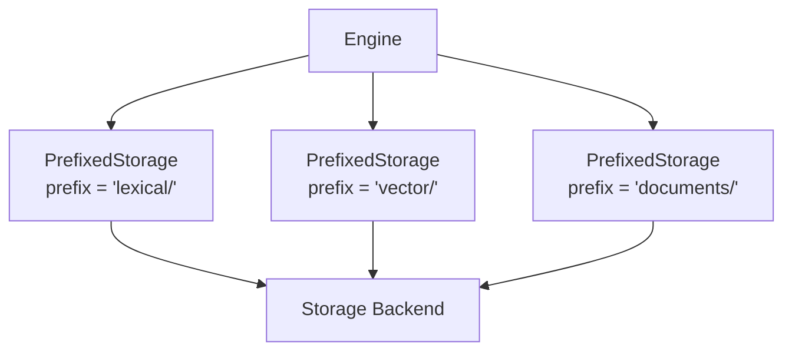

# Storage

Laurus uses a pluggable storage layer that abstracts how and where index data is persisted. All components — lexical index, vector index, and document log — share a single storage backend.

## The Storage Trait

All backends implement the `Storage` trait:

```rust
pub trait Storage: Send + Sync + Debug {
    fn loading_mode(&self) -> LoadingMode;
    fn open_input(&self, name: &str) -> Result<Box<dyn StorageInput>>;
    fn create_output(&self, name: &str) -> Result<Box<dyn StorageOutput>>;
    fn file_exists(&self, name: &str) -> bool;
    fn delete_file(&self, name: &str) -> Result<()>;
    fn list_files(&self) -> Result<Vec<String>>;
    fn file_size(&self, name: &str) -> Result<u64>;
    // ... additional methods
}
```

This interface is file-oriented: all data (index segments, metadata, WAL entries, documents) is stored as named files accessed through streaming `StorageInput` / `StorageOutput` handles.

## Storage Backends

### MemoryStorage

All data lives in memory. Fast and simple, but not durable.

```rust
use std::sync::Arc;
use laurus::Storage;
use laurus::storage::memory::MemoryStorage;

let storage: Arc<dyn Storage> = Arc::new(
    MemoryStorage::new(Default::default())
);
```

| Property | Value |
| :--- | :--- |
| Durability | None (data lost on process exit) |
| Speed | Fastest |
| Use case | Testing, prototyping, ephemeral data |

### FileStorage

Standard file-system based persistence. Each key maps to a file on disk.

```rust
use std::sync::Arc;
use laurus::Storage;
use laurus::storage::file::{FileStorage, FileStorageConfig};

let config = FileStorageConfig::new("/tmp/laurus-data");
let storage: Arc<dyn Storage> = Arc::new(FileStorage::new("/tmp/laurus-data", config)?);
```

| Property | Value |
| :--- | :--- |
| Durability | Full (persisted to disk) |
| Speed | Moderate (disk I/O) |
| Use case | General production use |

### FileStorage with Memory Mapping

`FileStorage` supports memory-mapped file access via the `use_mmap`
configuration flag. When enabled, the OS manages paging between memory
and disk; the lexical posting decoder (Issue #504) takes a zero-copy
path through `StorageInput::as_slice`, handing PFOR-bit-packed blocks
directly to `bitpacking::decompress*` instead of allocating an
intermediate `Vec<u8>` and copying through `Read`.

**Default is `true` on every platform:** Unix (Linux / macOS / *BSD)
as of Issue #504 and Windows as of Issue #508. Set the
`LAURUS_NO_MMAP=1` environment variable when constructing the config
(via `FileStorageConfig::new`) to fall back to buffered file I/O for
debug sessions or hosts where mmap misbehaves.

Windows holds an exclusive lock on memory-mapped files
(`ERROR_USER_MAPPED_FILE`, os error 1224), which blocks truncating or
deleting a file while it is mapped. `FileStorage` therefore drops its
cached mapping of a file before it truncates, deletes or renames that
file.

```rust
use std::sync::Arc;
use laurus::Storage;
use laurus::storage::file::{FileStorage, FileStorageConfig};

// mmap is on by default on every platform unless LAURUS_NO_MMAP=1
// is set.
let config = FileStorageConfig::new("/tmp/laurus-data");
let storage: Arc<dyn Storage> = Arc::new(FileStorage::new("/tmp/laurus-data", config)?);

// Explicit opt-out without touching the env var (works on any OS).
let mut buffered_config = FileStorageConfig::new("/tmp/laurus-data");
buffered_config.use_mmap = false;

// Explicit opt-in, even when LAURUS_NO_MMAP=1 is set (works on any OS).
let mut mmap_config = FileStorageConfig::new("/tmp/laurus-data");
mmap_config.use_mmap = true;
```

| Property | Value |
| :--- | :--- |
| Durability | Full (persisted to disk) |
| Speed | Fast (OS-managed memory mapping; zero-copy posting decode) |
| Use case | Default for any production-scale workload |

## StorageFactory

You can also create storage via configuration:

```rust
use laurus::storage::{StorageConfig, StorageFactory};
use laurus::storage::memory::MemoryStorageConfig;

let storage = StorageFactory::create(
    StorageConfig::Memory(MemoryStorageConfig::default())
)?;
```

## PrefixedStorage

The engine uses `PrefixedStorage` to isolate components within a single storage backend:



When the lexical store writes a key `segments/seg-001.dict`, it is actually stored as `lexical/segments/seg-001.dict` in the underlying backend. This ensures no key collisions between components.

You do not need to create `PrefixedStorage` yourself — the `EngineBuilder` handles this automatically.

## ColumnStorage

In addition to the primary storage backends, Laurus provides a `ColumnStorage` layer for fast field-level access. This is used internally for operations like faceting, sorting, and aggregation, where accessing individual field values without deserializing entire documents is important.

### ColumnValue

`ColumnValue` represents a single stored column value:

| Variant | Description |
| :--- | :--- |
| `String(String)` | UTF-8 text |
| `I32(i32)` | 32-bit signed integer |
| `I64(i64)` | 64-bit signed integer |
| `U32(u32)` | 32-bit unsigned integer |
| `U64(u64)` | 64-bit unsigned integer |
| `F32(f32)` | 32-bit floating point |
| `F64(f64)` | 64-bit floating point |
| `Bool(bool)` | Boolean |
| `DateTime(i64)` | Unix timestamp (seconds) |
| `Null` | Absent value |

ColumnStorage is managed internally by the Engine -- you do not need to interact with it directly.

## Choosing a Backend

| Factor | MemoryStorage | FileStorage | FileStorage (mmap) |
| :--- | :--- | :--- | :--- |
| **Durability** | None | Full | Full |
| **Read speed** | Fastest | Moderate | Fast |
| **Write speed** | Fastest | Moderate | Moderate |
| **Memory usage** | Proportional to data size | Low | OS-managed |
| **Max data size** | Limited by RAM | Limited by disk | Limited by disk + address space |
| **Best for** | Tests, small datasets | General use | Large read-heavy datasets |

### Recommendations

- **Development / Testing**: Use `MemoryStorage` for fast iteration without file cleanup
- **Production (general)**: Use `FileStorage` for reliable persistence
- **Production (large scale)**: Use `FileStorage` with `use_mmap = true` when you have large indexes and want to leverage OS page cache

## Next Steps

- Learn how the lexical index works: [Lexical Indexing](indexing/lexical_indexing.md)
- Learn how the vector index works: [Vector Indexing](indexing/vector_indexing.md)
