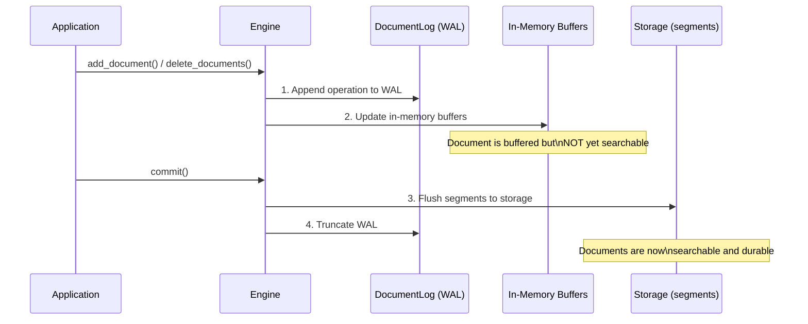
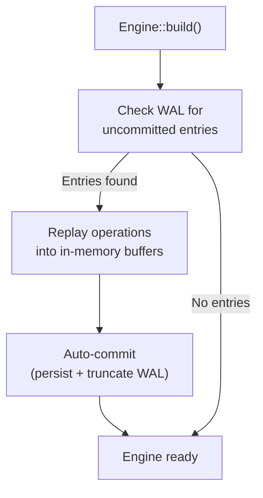

# Persistence & WAL

Laurus uses a **Write-Ahead Log (WAL)** to ensure data durability. Every write operation is persisted to the WAL before modifying in-memory structures, guaranteeing that no data is lost even if the process crashes.

## Write Path



### Key Principles

1. **WAL-first**: Every write (add or delete) is appended to the WAL before updating in-memory structures. Everything that can reject a write runs before that append (embedding and validating its vector fields, creating the writers, analyzing its lexical fields, flushing a full lexical buffer), and a failure after it stops writes until the index is reopened. From that append to its finish a write runs without an `.await`, so cancelling its call cannot leave it half applied (see [Failed Writes](#failed-writes))
2. **Buffered writes**: In-memory buffers accumulate changes until `commit()` is called
3. **Atomic commit**: `commit()` flushes all buffered changes to segment files and truncates the WAL
4. **Commit-scoped visibility**: a lexical segment is written as soon as the writer's buffer fills, which can happen long before `commit()`, so the segment files existing on storage is not what makes its documents searchable. Publication is a manifest entry that only `commit()` adds, and segment discovery reads only the manifest — so "documents become searchable only after `commit()`" holds regardless of when a searcher happens to be built. Deletions are published in the same step, after their bitmaps are durable, so a reader that can see a segment can always filter it
5. **Crash safety**: If the process crashes between writes and commit, the WAL is replayed on the next startup
6. **Atomic file writes**: Segment files (e.g. the HNSW `.hnsw` graph, its metadata, and the deletion bitmap) are written to a temporary file and atomically renamed into place, so a crash mid-write leaves the previously committed file intact rather than a truncated one
7. **Checksum verification**: Those files carry a CRC-32 (a footer on `.hnsw` and the `.hnsw.f32` rerank sidecar, framing on `metadata.json`) that is verified on load, so silent on-disk corruption is detected instead of being read as valid data. Files written before checksums were added still load (the checksum is optional per file). Lexical segment parts (`.dict`, `.post`, `.docs`, `.norms`, `.ids`, `.bkd`), deletion bitmaps (`.delmap`) and the checksummed manifests end in an 8-byte footer: a CRC-32 of every byte before it, then the magic `LCRC`. Parts read front to back are verified as they load, when a segment opens. `.post` and `.bkd` are read by random access, so they are verified when a merge reads a segment, which keeps corruption from being copied into the merged segment under a fresh checksum. The merged segment is then verified in full. Document store segments (`doc_segment_NNNNNN.docs`) carry the same footer and are verified in full when a segment is first read after it is written or the store is reopened, as its offset index is built; a corrupted one fails every read of it. Files written before this footer existed end in a 4-byte trailer that covered only their last write. They still load, unverified; manifests and `.ids` are the exception, because their last write is their whole payload, so their trailer is still checked. Loaders also bound buffer allocations against the real file size before trusting a header, so a corrupt size field is rejected as corruption rather than triggering a huge out-of-memory allocation. The lexical term dictionary and posting-list decoders likewise check each block, the FST header and each skip table against what the writer produces, so a corrupt one fails with a corruption error instead of a panic. They also reject data that decodes but is inconsistent, rather than serving wrong results: keys that are out of order or not valid UTF-8, block-max entries that do not ascend or carry a NaN or negative factor, doc ids that repeat, descend or fall outside the segment, and a posting list whose term, length, document count or block boundaries differ from its dictionary entry
8. **Versioned segment headers**: Vector segments carry a format version in their shared header, forming a feature ladder. Version 2 (HNSW only) stores the graph block as segment-local 32-bit ordinals instead of 64-bit document ids (roughly halving the graph block on disk). Version 3 (all vector index types) adds a per-segment field-name dictionary: records reference field names by a 16-bit id instead of repeating the full name inline, shrinking every record by the name's length plus two bytes. New segments are written at version 3; segments written by older builds (versions 1 and 2) still load and are upgraded on the next rewrite (compaction or merge)

## Write-Ahead Log (WAL)

The WAL is managed by the `DocumentLog` component and stored at the root level of the storage backend (`engine.wal`).

### WAL Entry Types

| Entry Type | Description |
| :--- | :--- |
| **Upsert** | Document content + external ID + assigned internal ID, and the internal IDs of the versions it replaces (a `put`'s previous versions; none for an `add`) |
| **Delete** | External ID and the internal IDs of every document it removes |

Every `put`, `add` and delete writes exactly one entry, which recovery replays whole: a `put`'s previous versions are deleted together with the insert, and a delete of several chunks removes all of them ([#1522](https://github.com/mosuka/laurus/issues/1522)). A WAL from before v4 holds a `put`'s deletes, and each document of a delete, as entries of their own, and replays as it always did.

### WAL File

The WAL file (`engine.wal`) is an append-only binary log. Each entry is self-contained with:

- Operation type (upsert/delete)
- Sequence number
- Payload (document data and internal IDs)

### On-disk framing

The file begins with a 5-byte header (`b"LWAL"` magic + a version byte) followed by length-prefixed records. There are four framings. Only v4 is written: a file in an older framing that survives an upgrade is read as it is, and rewritten in v4 before the first append to it (unless a commit empties it first), so formats are never mixed within one file:

| Version | Framing | Payload |
| :--- | :--- | :--- |
| **v4** (current) | `[u32 len][u32 crc32][payload]` | compact **rkyv binary** record, one per write |
| **v3** | `[u32 len][u32 crc32][payload]` | rkyv binary record, a `put`'s deletes in records of their own (read-only) |
| **v2** | `[u32 len][u32 crc32][payload]` | JSON record of the v3 entries (read-only, back-compat) |
| **legacy** (pre-CRC) | `[u32 len][payload]` | JSON record, no checksum (read-only) |

The CRC-32 (v2 and later) is computed over `len || payload`, detecting both a corrupted length and a corrupted body. The reader recovers all four formats, so a WAL written by an older build still replays after an upgrade.

Since v3, each payload is a compact rkyv binary record rather than JSON. Vectors store as raw `f32` (4 bytes each) instead of decimal strings, so for vector-heavy documents the WAL is roughly 2-3x smaller and replays correspondingly faster — without changing durability (the CRC framing and recovery semantics are unchanged).

A WAL whose header names a version this build does not know was written by a newer build. Opening the index fails with `LaurusError::IncompatibleFormat`, whose message names the version, and the file is left as it is, so the newer build can still replay it ([#1507](https://github.com/mosuka/laurus/issues/1507)). An older build cannot read a v4 WAL either: a build from before v4 reads it as v2 and recovers nothing from it. A commit leaves the WAL empty, so an index committed by the newer build carries no WAL records.

## Recovery

When an engine is built (`Engine::builder(...).build().await`), it automatically checks for remaining WAL entries and replays them (the WAL is truncated on commit, so any remaining entries are from a crashed session). Recovery finishes with an **automatic commit**: the replayed state — including deletions, whose persistence is [group-committed](deletions.md#group-committed-persistence) — is persisted and immediately searchable, and the WAL is truncated, so a subsequent crash has nothing to re-replay:



Recovery is transparent — you do not need to handle it manually. Note that a post-crash open therefore does commit-scale work (segment flush, index writes), and `Engine::build` returns an error if that commit fails (e.g. the disk is full); reopening after the condition clears is safe, since replay is idempotent and the WAL is only truncated after the commit succeeds.

A crash in the middle of an append can leave the WAL ending in an incomplete record. Recovery replays the records before it and, before anything new is appended, cuts the file back to the end of the last complete record: a write made after the reopen is then not stored behind the incomplete record, where the next recovery would stop before reaching it. Recovery stops at the first record it cannot read in full or whose CRC does not match, and never skips a bad record to replay the ones after it, so the cut drops everything from that record on.

A `put`/`add` call rejected for a caller-input reason — an unsupported input type for a field's embedder, a vector of the wrong dimension, an unconfigured field — never reaches the WAL (the document's vector fields are embedded and validated before anything is written or deleted), so it leaves no replayable record for a later recovery to retry. The same holds for a document the lexical analyzer rejects and for a flush of a full lexical buffer that fails: both run before the append too. An index that an older build already left with a caller-input record still in its WAL replays it once more: recovery logs a warning and discards the record instead of failing to open, since the call that originally wrote it already returned that same error to its caller. A record rejected for any other reason (e.g. a remote embedder temporarily unreachable, or an analyzer error, which can also be transient) still fails recovery and is retried on the next open, as before.

## Failed Writes

A write that fails returns its error, and what it changed depends on where it failed:

| Where it fails | For example | Outcome |
| :--- | :--- | :--- |
| Before its WAL append | A rejected embedding, an analyzer error, a writer that cannot be created, a failed flush of a full lexical buffer; the call cancelled (its future dropped, as when a `laurus serve` client's request is cancelled, its deadline expires or the client disconnects), for example while it waits for the vector writer that a commit holds | Nothing changed: no WAL record is written, and a `put` keeps the previous version. The engine keeps accepting writes. |
| At or after its WAL append | An I/O error writing the WAL record or loading a deletion bitmap; a panic before the write finished applying | The engine **stops accepting writes**. Reopening the index applies the whole write if its record reached the WAL in full; otherwise the write changed nothing, and a `put` keeps its previous versions. |

A write takes everything it waits for, such as the vector writer, before its WAL append, and from that append to its finish it runs without an `.await` ([#1517](https://github.com/mosuka/laurus/issues/1517)). Cancelling its call therefore takes effect either before that append, which leaves nothing behind, or after the write finished, which leaves it applied even though the caller never sees the result. Retrying a cancelled `put` of the same id is safe either way, while retrying a cancelled `add` can add the chunk twice. A cancelled `put_documents` or `add_documents` keeps the documents it applied before the cancellation; they become durable at the WAL's next fsync rather than at the one the batch runs when it ends.

A write appends one WAL record ([#1522](https://github.com/mosuka/laurus/issues/1522)): a `put`'s names the previous versions it replaces, and a delete's every document it removes. The write changes the in-memory index only after that append, so a failed append leaves the index as it was. From the append on, the in-memory index may disagree with the WAL, and going on would let a commit persist the disagreement or a later write build on it. Once writes stopped:

- Every `put`, `add`, delete, `commit()` (also from `CommitPolicy::EveryDocs` and `Interval`, which skip their commits instead) and schema change (`add_field`, `delete_field`, `update_field`) fails with `LaurusError::WritesStopped`, whose message names the original failure. `Engine::write_stop_reason()` returns it.
- Searches and lookups keep working. They may show the failed write half applied, for example a `put`'s previous version already gone from vector results.
- No commit runs, so the WAL keeps every record since the last commit, and an engine dropped while stopped discards its lexical writer instead of committing it.
- Reopening the index (for `laurus serve`, restarting it) replays the WAL, with every write acknowledged since the last commit. The failed write is applied whole if its record reached the WAL in full: a failed `put` replaces its previous versions, and a failed delete removes every chunk. Otherwise it changed nothing. It is never applied in part. Fix the cause first (e.g. free disk space): if the replay fails again, the open fails and can be retried.

An append that failed partway through writing its record also makes every later append fail, because recovery stops at the first incomplete record and would lose any record written after it. Reopening the index cuts the incomplete record off (see [Recovery](#recovery)), and appends work again.

The WAL keeps the failed write's record with concurrent writers too, even against a commit that was already running when the write failed: a commit truncates the WAL, and records the stores' checkpoints, only up to the highest sequence number at or below which every write had finished applying when the commit started. A write that never finishes holds that number below its record until the index is reopened ([#1499](https://github.com/mosuka/laurus/issues/1499); see the [commit ladder](#commit-durability-ladder--crash-safety)).

## The Commit Lifecycle

```rust
// 1. Add documents (buffered, not yet searchable)
engine.add_document("doc-1", doc1).await?;
engine.add_document("doc-2", doc2).await?;

// 2. Commit — flush to persistent storage
engine.commit().await?;
// Documents are now searchable

// 3. Add more documents
engine.add_document("doc-3", doc3).await?;

// 4. If the process crashes here, doc-3 is in the WAL
//    and will be recovered on next startup
```

### When to Commit

| Strategy | Description | Use Case |
| :--- | :--- | :--- |
| **After each document** | Maximum durability, minimum search latency | Real-time search with few writes |
| **After a batch** | Good balance of throughput and latency | Bulk indexing |
| **Periodically** | Maximum write throughput | High-volume ingestion |

> **Tip:** Commits are relatively expensive because they flush segments to storage. For bulk indexing, batch many documents before calling `commit()`.

### Auto-commit Policy

Instead of calling `commit()` yourself, you can let the engine run the commit ladder automatically at an ingestion-driven cadence via `CommitPolicy`, configured on the builder:

```rust
use laurus::CommitPolicy;

let engine = Engine::builder(storage, schema)
    // Commit automatically after every 1,000 applied documents.
    .commit_policy(CommitPolicy::EveryDocs(1000))
    .build()
    .await?;

// No explicit commit() needed — every 1,000th document triggers one.
engine.put_documents(one_thousand_docs).await?;
```

| Policy | Behavior |
| :--- | :--- |
| `Manual` (default) | Never auto-commits; you drive every `commit()`. Identical to the historical behavior. |
| `EveryDocs(n)` | Runs the commit ladder after every `n` applied documents, across the singular and batch APIs. `EveryDocs(0)` disables auto-commit (same as `Manual`). |
| `Interval(Duration)` | Runs the commit ladder at least every `Duration` via a background timer, so a trailing partial batch is committed even while ingestion is idle. `Interval(Duration::ZERO)` disables auto-commit (same as `Manual`) and starts no timer. **Native targets only** — a no-op on `wasm32` (no background threads), like a non-zero `WalSyncPolicy::Group` `max_interval`. |

Key semantics:

- **Group-commit preserved.** Each auto-commit is one WAL flush plus one materialization ladder — never one commit per document. Within a single `put_documents` / `add_documents` call the auto-commit fires **every `n` documents** (chunked), so a large batch materializes incrementally rather than in one final ladder; the trailing `< n` remainder stays WAL-durable until the next boundary or an explicit `commit()`.
- **Orthogonal to `WalSyncPolicy`.** `CommitPolicy` decides *when the stores materialize*; `WalSyncPolicy` decides *WAL fsync durability*. Auto-commit works under any WAL policy because `commit()` always begins with a WAL flush.
- **Crash semantics unchanged.** An auto-commit is a normal commit; a crash replays the uncommitted tail exactly as it would under manual commits.
- **Concurrency.** The exact cadence holds for **single-writer ingestion** (the model the engine's write path — and the CLI/bindings — are built around). Under concurrent writers on a shared engine, the cadence is best-effort and may drift, and a commit does not wait for writes still applying: a write that finishes while an auto-commit (or a concurrent manual `commit()`, which races the same way) runs keeps its WAL record and reaches the stores' committed state at the following commit. An acknowledged write is never lost to such a race: no commit truncates the record of a write that has not finished applying, or records a checkpoint that covers it (Issue #1499; see the [commit ladder](#commit-durability-ladder--crash-safety)). The `Interval` timer runs the ladder on its own thread, with the same behavior.

## Batch Ingestion

`put_documents` / `add_documents` are the batched forms of `put_document` / `add_document`. They apply their `(id, doc)` pairs **sequentially, in input order**, and under the default `PerRecord` policy they make the whole batch durable with a **single WAL fsync at batch end** instead of one per record:

```rust
let docs: Vec<(String, Document)> = build_batch();
engine.put_documents(docs).await?; // one fsync, all docs as durable as singular puts
engine.commit().await?;            // one commit publishes the whole batch
```

Semantics to be aware of:

- **Ordering**: duplicate external IDs within one `put_documents` batch dedup exactly like the same puts issued sequentially — the last occurrence wins. Repeating an ID in `add_documents` legitimately appends multiple chunks.
- **Fail-fast, no rollback**: the batch stops at the first document that cannot be applied and returns `LaurusError::BatchIngest { failed_index, failed_id, applied, .. }`. The `applied` documents before the failure are **not** rolled back — they stay in the WAL and NRT buffers (resolvable by `_id` immediately, searchable after the next `commit()`, durable at that commit, replayed on crash recovery), and the batch-end WAL flush runs on the error path too. Retrying the batch, or its suffix starting at `failed_index`, is idempotent under put semantics. The failing document follows the [single-write rules](#failed-writes): rejected before its WAL append, it changed nothing; failing after it, it stopped writes, and `source` holds its own error. Once writes stopped, a batch fails at its first document with `WritesStopped` as `source`.
- **Durability**: when the call returns `Ok`, every document in the batch is exactly as durable as a successful singular put. A crash mid-call loses at most the un-fsync'd tail; recovery replays the fsync'd prefix per document, and a torn trailing record is dropped by the CRC framing as usual.
- **Sizing**: the engine clones each document into the WAL as it goes, so batch memory is dominated by the caller's `Vec`. Batches of 1,000-10,000 documents per call are a good default; chunk larger corpora into multiple calls (and commit periodically to bound segment sizes).
- **Under `Group` policy**: the group thresholds keep firing mid-batch, so that policy's bounded loss window is preserved; the batch-end flush still runs.
- **Concurrent singular writes**: a `put_document` / `add_document` / `delete_documents` call that completes while another task's batch is in flight keeps its full per-record durability — singular writes re-assert the fsync before acknowledging, so a batch never weakens anyone else's guarantee.

## WAL Durability Policy

By default, each `add`/`delete` fsyncs the WAL before returning, so a successful write can never be lost to a crash. When ingesting at high volume, that per-write fsync becomes the throughput bottleneck. The `WalSyncPolicy` lets you trade per-write durability for throughput:

| Policy | Durability | Throughput | Analogue |
| :--- | :--- | :--- | :--- |
| `PerRecord` (default) | Every successful write is durable | Bounded by one fsync per write | SQLite `synchronous = FULL` |
| `Group { max_records, max_bytes }` | A crash may lose up to the last unsynced batch | fsync amortized over a batch | SQLite `synchronous = NORMAL` |

Under `Group`, the fsync is deferred and issued once **either** `max_records` records **or** `max_bytes` bytes have accumulated since the last sync (whichever comes first). A record is one write: a `put`, `add` or delete, however many versions or chunks it replaces or removes. Configure it on the builder:

```rust
use laurus::WalSyncPolicy;
use std::time::Duration;

let engine = Engine::builder(storage, schema)
    // Group commit with the default thresholds (1024 records / 1 MiB), no timer.
    .wal_sync_policy(WalSyncPolicy::group_with_defaults())
    // ...the default thresholds plus a periodic flush every 500 ms:
    // .wal_sync_policy(WalSyncPolicy::group_with_interval(Duration::from_millis(500)))
    // ...or choose your own batch size and timer:
    // .wal_sync_policy(WalSyncPolicy::Group {
    //     max_records: 4096,
    //     max_bytes: 4 * 1024 * 1024,
    //     max_interval: Some(Duration::from_secs(1)),
    // })
    .build()
    .await?;
```

### Periodic Flush Timer

`Group.max_interval` adds a time bound to the size-based thresholds. When set, the engine runs a background timer that forces the WAL durable at least that often, so a trailing partial batch under a **low ingest rate** — where the record/byte thresholds may never be reached — is not left unsynced indefinitely. The flush is a no-op when nothing is pending, so an idle timer costs nothing. `None` disables the timer. `Some(Duration::ZERO)` allows no unsynced time at all: no timer is started and every append syncs, the same as a zero `max_records` or `max_bytes`.

> **WASM note:** the timer is honored on native targets only. On `wasm32` there are no background threads, so a non-zero `max_interval` is ignored; durability there relies on the record/byte thresholds, `commit()`, and `flush_wal()`. A zero `max_interval` needs no timer, so it syncs every append on `wasm32` too.

### Durability Guarantees

- **`commit()` is a hard barrier under both policies.** It forces the WAL durable before materializing any store, so the WAL is never less durable than the committed indexes. After a successful `commit()`, all data is durable regardless of policy.
- **Schema changes are barriers too.** `add_field`, `delete_field`, and an `update_field` that rebuilds or discards a field (a `Reindex` or `Destructive` change) commit the stores' writers outside the commit ladder, and a vector `Reindex` also writes the field's deletions there, so they force the WAL durable first, as `commit()` does ([#1527](https://github.com/mosuka/laurus/issues/1527), [#1537](https://github.com/mosuka/laurus/issues/1537)). A `DynamicFieldPolicy::Dynamic` put that adds a field does the same, also in the middle of a batch.
- **Dropping the engine forces the WAL durable too.** The engine's lexical writer commits when the engine is dropped, outside the commit ladder, so the drop flushes the WAL first. If that flush fails, the drop discards the writer instead of committing it, and the next open replays the records the WAL kept ([#1537](https://github.com/mosuka/laurus/issues/1537)).
- **Adding a vector field, and a `Destructive` `update_field` of one, commit first.** The field starts empty, so they run `commit()` before they recreate it. Puts and deletes wait for the schema change, so the commit leaves the WAL empty, and recovery never replays a record written before the field was recreated into it ([#1535](https://github.com/mosuka/laurus/issues/1535)).
- **`flush_wal()` forces a flush on demand** without a full commit — the way to bound the crash-loss window under `Group` at an application-chosen point, analogous to a SQLite WAL checkpoint:

  ```rust
  engine.add_document("doc-1", doc1).await?;
  engine.flush_wal()?; // the WAL is now durable, without committing segments
  ```

- **A torn trailing record is never resurrected.** Each record is CRC-32 framed; on recovery a record that fails its checksum (or is truncated) is dropped along with everything after it, so the recovered log is always a gap-free valid prefix — group commit only ever risks losing a *suffix* of recent writes, never corrupting earlier ones.

> **Note:** `Group` is opt-in; the default `PerRecord` policy is unchanged, so existing code keeps its per-write durability with no changes.

## Commit Durability Ladder & Crash Safety

`commit()` persists state in a fixed order, and the order is what makes a crash
at any point recoverable. Each lexical/vector store tracks its own `last_wal_seq`
checkpoint — a sequence number at or below which the store has materialized
every WAL record — so recovery can skip already-applied records. The persisted
`last_wal_seq` lives in the store's on-disk metadata and is written **only**
during the store's commit, which records the watermark the commit ladder
snapshots (below); writes do not move it.

The lexical control file (`metadata.json`) has a **single authority**: the
in-memory copy owned by the index. The writer the store commits through holds a
shared handle to it, records the commit's state (the document and deletion
counts, the WAL checkpoint) under that lock, and persists a snapshot — so no
code path can overwrite the file from a stale copy, and internal writers (such
as the merge engine's segment-replay writer) have no handle and cannot touch
the file at all. A pass with nothing to record skips the persist, and a failed
persist rolls the in-memory copy back to the persisted state — the retry
records the commit again, mirroring the manifest's failure contract below.

Lexical segment **discovery** follows the same authority model through
`segments.json`, an atomically replaced, checksummed manifest of the committed
segment set. Publication is all-or-nothing: a commit adds every flushed
segment in one manifest write, and a merge drops its sources and inserts the
merged segment in one write. The in-memory copy mirrors the last
*successfully persisted* manifest (a failed save leaves the pending state for
the retry), so reader construction is a pure in-memory read — no directory
listing, no per-segment metadata parse. There are no per-segment `.meta`
files any more: the manifest is the only record, files it does not list are
reclaimed at the next open, and an index written before the manifest existed
is migrated by a one-time read of its legacy `.meta` files when opened.

The index's document and deletion counts are **derived from the manifest**.
Each entry records its segment's document count and how many of those
documents are deleted — recounted from the segment's deletion bitmap by every
commit that deletes from it — and the index's counts are the sums. The counts
in `metadata.json` are those sums as of the last commit; the index never reads
them back, so a crash between the manifest save and the metadata write, a
repeated upsert of one id, or a merge that drops deleted documents cannot skew
them. A manifest written by an older build records no deletion counts: opening
it recounts them from the bitmaps without writing anything, and the next
manifest write persists them.

Segment data itself is written as one **compound container** per segment
(`segment_<N>.cfs` — postings, term dictionary, stored documents, field
lengths and statistics, the segment's doc-id set, doc values and per-field
BKD trees, concatenated
with a trailing part table): one file create and one fsync per flush instead
of one per part. The deletion bitmap (`.delmap`) stays a separate file, as
the only per-segment data rewritten after sealing — written the same
temp-file-then-rename way as the container itself (item 6 above), so a crash
mid-rewrite leaves the previously committed bitmap intact. Readers detect the layout
per segment, so indexes with older loose-file segments keep working
unchanged, and merges rewrite them into containers over time.
`LAURUS_NO_COMPOUND=1` restores the loose layout as a transitional escape
hatch.
Opening an index whose `segments.json` is missing while segment files are
present is refused loudly rather than served as silently empty. Three
consequences worth knowing: at most **one writing store instance per
directory** is supported (concurrent instances would overwrite each other's
manifest); a standalone `InvertedIndexWriter` is an ephemeral tool — its
commits register segments nowhere, and such files in a manifest-owned
directory are reclaimed; and a pre-manifest binary opening a post-manifest
index finds no `.meta` files and sees it as empty — a one-way format step
worth a release note.

The commit ladder is:

1. **`flush_wal()`** — force the WAL durable (the hard barrier). Under `Group`
   this fsyncs any deferred batch; under `PerRecord` it is a no-op.
2. **`lexical.commit()`** — record the watermark as `last_wal_seq`, write the
   lexical segment and metadata, then `sync()`.
3. **`vector.commit()`** — record the watermark as each field's checkpoint,
   write the vector segment and deletion bitmaps, publish the checkpoint, then
   `sync()`.
4. **`commit_documents()`** — write the document store segment, then `sync()`.
5. **`truncate_retaining_after(watermark)`** — discard every WAL record this
   commit covered; **retain** every record above the watermark, which includes
   every record whose mutation had not finished applying to both stores when
   the commit started (Issues #876, #1499).

This order guarantees two invariants:

- **The WAL is never less durable than any persisted index.** `last_wal_seq` is
  only persisted in step 2+, which always runs *after* the step-1 barrier, so a
  committed index can never reference a WAL record that is not yet durable.
- **Every store is fully durable before the WAL is truncated.** Steps 2–4 each
  `sync()` before step 5 discards the covered portion of the WAL, so nothing is
  discarded before the data it described is safely materialized.

`commit()` is **not** serialized against concurrent `put`/`add`/`delete` calls
(nor against `CommitPolicy::Interval`'s background timer, which runs this same
ladder). It accounts for this with a **watermark** it snapshots *before* step 1
runs: the highest sequence number at or below which every write has finished
applying to both stores. Writes of different ids finish in any order, so a
write appended later can finish first; the watermark stays below the earlier
one until it finishes. Steps 2 and 3 record the snapshot as the stores'
checkpoints, each under the lock its own commit holds (a lexical store with
nothing buffered keeps its previous checkpoint, which only means more replay),
and step 5 retains every WAL record past it instead of unconditionally emptying
the file. A write racing
the commit therefore keeps its WAL record — and is replayed on the next
recovery — even if this commit materialized part of it, and no checkpoint
covers it. A write that never finishes (it failed or panicked, which also
stops writes) holds the watermark below its record until the index
is reopened (Issue #1499). When nothing races the commit (the common case), the
snapshot covers the whole WAL and step 5 empties the file exactly as before.

Recovery replays the WAL on the next `build()`, skipping records at or below each
store's `last_wal_seq`. Replay is **idempotent** — it re-applies each record
under its originally recorded `doc_id`, so re-running it overwrites rather than
duplicates. Because each store keeps its own checkpoint, a commit that fails
partway leaves the stores at different `last_wal_seq` values and recovery simply
re-applies what each store is missing. The vector store's checkpoint is the
lowest of its fields' (each field publishes its own at the end of the vector
commit), so a field that lags behind gets its records replayed; a field on a
monolithic (non-segmented) vector index keeps its checkpoint at `0`, which
replays the full retained WAL into the vector store on every recovery — correct
and idempotent, just not optimized.

Sequence numbers continue across opens. A commit empties the WAL, so before
reading it `build()` raises the WAL's sequence counter above the highest
checkpoint any store persisted: the lexical one and every vector field's. A
write made after a reopen therefore always lands above every checkpoint, and a
crash before the next commit replays it (Issue #1502).

> **Note:** Before Issue #1502 was fixed, the sequence restarted at 1 on every
> open over an empty WAL, at or below the checkpoints. A write such a build
> made after a reopen, left only in the WAL by a crash before the next commit
> and numbered at or below a checkpoint, is skipped by recovery in any build:
> a new document is missing, an overwrite reverts to the previous version, and
> a delete is undone. Nothing recovers these writes; re-ingest what was written
> since that reopen. It cannot happen again once a build with the fix has
> opened the index.

The table below shows the outcome of a crash at each step (identical for
`PerRecord` and `Group`, because the step-1 barrier has already run):

| Crash point | Durable on disk | Recovery outcome |
| --- | --- | --- |
| After step 1, before step 2 | WAL only | Replay all pending records into both stores |
| After step 2, before step 3 | WAL + lexical (`last_wal_seq = N`) | Lexical skips ≤ N; vector replays from WAL |
| After step 3, before step 4 | WAL + lexical + vector | Both stores skip; documents restored from WAL |
| After step 4, before step 5 | WAL + all stores | WAL still present; both stores skip records up to the watermark, and replay any above it idempotently, so no duplicates |
| After step 5 | All stores; WAL empty unless a mutation raced this commit | Nothing to replay (or just the racing mutation's record) |

No interleaving lets a committed index reference a lost WAL record, so group
commit introduces no new durability gap beyond its documented contract (a crash
can lose a *suffix* of writes not yet made durable by `flush_wal()` or `commit()`).

## Storage Layout

The engine uses `PrefixedStorage` to organize data:

```text
<storage root>/
├── lexical/          # Inverted index segments
│   ├── seg-000/
│   │   ├── terms.dict
│   │   ├── postings.post
│   │   └── ...
│   └── metadata.json
├── vector/           # Vector index, one directory per field
│   └── <field>/
│       ├── segment_000000.hnsw   # one file per segment: .hnsw, .flat, .ivf or .mv
│       ├── segments.json         # segment manifest
│       └── index.delmap          # deletion bitmap
├── documents/        # Document storage
│   └── ...
└── engine.wal        # Write-ahead log
```

`<storage root>` is a layout-agnostic abstraction: the engine itself has no
concept of `schema.toml` or where its storage root sits within a larger
directory. `laurus-cli`, `laurus-server`, and the language bindings
(Python, Node.js, Ruby, PHP) all place `<storage root>` at
`<index_dir>/store/`, alongside a `<index_dir>/schema.toml` holding the
schema — a convention owned by those entry points, not the engine. This
means an index directory created by one of them can be opened by any of
the others without restructuring anything on disk; see each binding's
`Index`/`create index` documentation for the exact create-vs-reopen
semantics (in particular, reopening an existing index only needs the
directory path — the persisted schema is loaded automatically).

A vector field's `segments.json` also records the index kind, dimension and
distance its segments are written with, and opening the field under a
schema that gives another one fails, since the segments cannot be read
under it ([#1547](https://github.com/mosuka/laurus/issues/1547)). A
manifest written before the record existed is checked against what the
segment files show (their kind and dimension), and the next manifest write
adds the record. A build older than the record drops it when it rewrites
the manifest, so after such a build has written to the field, the check
falls back to the segment files again. See
[Editing an existing vector field](../laurus-cli/schema_format.md#editing-an-existing-vector-field).

## Next Steps

- How deletions are handled: [Deletions & Compaction](deletions.md)
- Storage backends: [Storage](../concepts/storage.md)
